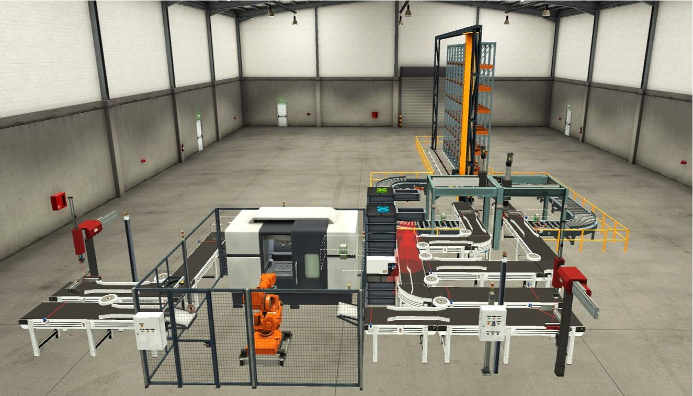

# Diseño y programación de una línea automatizada con TIA Portal y Factory I/O

Proyecto final del **CFGS en Automatización y Robótica Industrial (2024)**, realizado por **Carlos Villar Cejalvo**.

El proyecto consiste en el **diseño, programación y simulación de una línea automatizada** mediante **Siemens TIA Portal V17**, **S7-PLCSIM** y **Factory I/O**, incorporando además una **interfaz HMI/SCADA** para supervisión y control.

## Resumen del proyecto

La línea simulada integra las siguientes etapas:

1. **Entrada y alimentación de piezas** mediante un cilindro neumático y cintas transportadoras.
2. **Manipulación en modo manual o automático** mediante un robot industrial que introduce las piezas en la estación de mecanizado.
3. **Clasificación en la salida** mediante dos cámaras, sensores y cilindros neumáticos que desvían las piezas hacia una u otra línea según su color.
4. **Paletizado** de piezas en líneas diferenciadas mediante sistemas **Pick & Place XYZ**.
5. **Almacenamiento automático** del palé mediante grúa y estanterías.
6. **Supervisión HMI/SCADA** con distintos perfiles de usuario, estados del proceso y visualización del almacén.

---

## Vista general de la instalación



---

## Vídeos de demostración

### 1) Funcionamiento de la línea

**[Ver demostración de la línea (MP4)](Media/Videos/Demostracion-Linea.mp4)**

El vídeo resume el funcionamiento completo de la instalación y muestra, en orden, los momentos más representativos:

| Etapa | Contenido mostrado |
|---|---|
| Entrada | Alimentación mediante cilindro neumático y transporte por cintas |
| Robot y mecanizado | Manipulación manual o automática e introducción de piezas en la estación de mecanizado |
| Clasificación | Detección del color mediante cámaras y sensores, y desvío mediante cilindros neumáticos |
| Paletizado | Recogida y colocación de piezas en palés mediante Pick & Place XYZ |
| Almacenamiento | Transporte del palé y depósito en la estantería automática |

### 2) Supervisión HMI/SCADA

**[Ver demostración del SCADA (MP4)](Media/Videos/Demostracion-SCADA.mp4)**

Este vídeo muestra:

- acceso con perfiles **OPERARIO** y **JEFE**,
- diferencia de permisos entre usuarios,
- mandos de **marcha**, **paro** y **reinicio**,
- comprobación visual en Factory I/O de la respuesta del proceso,
- visualización de estados de **marcha**, **parada** y **alarma**,
- representación de las posiciones del **almacén** y registro de palés.

---

## Galería de imágenes

### Sistema de almacenamiento automático


### SCADA de control


### SCADA del almacén


---

## Tecnologías utilizadas

- **Siemens TIA Portal V17**: programación del PLC y desarrollo de la HMI.
- **S7-PLCSIM**: simulación del PLC Siemens.
- **Factory I/O**: modelado y simulación 3D de la instalación.
- **GRAFCET**: definición de secuencias y lógica de funcionamiento.
- **Esquemas eléctricos y neumáticos**: documentación técnica del sistema.

---

## Estructura del repositorio

```text
siemens-tia-portal-factory-io/
├── README.md
├── TIA Portal/
│   └── Proyecto-Pick-And-Place-Funciona.zap17
├── Factory IO/
│   └── Pick & Place PROYECTO.factoryio
├── GRAFCET/
│   ├── Proceso-Entrada.pdf
│   ├── Parada-Proceso-Entrada.pdf
│   ├── Proceso-Salida-Parte-1.pdf
│   ├── Proceso-Salida-Parte-2.pdf
│   ├── Proceso-Salida-Parte-3.pdf
│   └── Parada-Proceso-Salida.pdf
├── Esquemas/
│   └── Esquemas-Electricos-y-Neumaticos.pdf
├── Documentacion/
│   ├── Funcionamiento.md
│   ├── Memoria-Resumida.pdf
│   └── Memoria-Completa-Original.pdf
└── Media/
    ├── Imagenes/
    └── Videos/
```

---

## Archivos más importantes

Si alguien quiere revisar el proyecto rápidamente, este sería el orden recomendado:

1. **README.md**
2. **Media/Videos/Demostracion-Linea.mp4**
3. **Media/Videos/Demostracion-SCADA.mp4**
4. **Documentacion/Memoria-Resumida.pdf**
5. **GRAFCET/**
6. **Esquemas/Esquemas-Electricos-y-Neumaticos.pdf**
7. **TIA Portal/Proyecto-Pick-And-Place-Funciona.zap17**
8. **Factory IO/**

---

## Cómo abrir el proyecto original

### TIA Portal

El archivo del proyecto se conserva en:

`TIA Portal/Proyecto-Pick-And-Place-Funciona.zap17`

Para abrirlo es necesario:

1. disponer de **Siemens TIA Portal V17** o una versión compatible,
2. restaurar el proyecto archivado desde la opción correspondiente del programa,
3. utilizar **S7-PLCSIM** para la simulación del PLC.

### Factory I/O

La escena principal conservada del proyecto se encuentra en:

- `Factory IO/Pick & Place PROYECTO.factoryio`

Esta es la escena que corresponde al proyecto original que quieres mostrar en el repositorio.

---

## Documentación incluida

### Memoria resumida

Se incluye una **selección reducida de páginas** de la memoria original en:

**[Documentacion/Memoria-Resumida.pdf](Documentacion/Memoria-Resumida.pdf)**

Esta versión concentra las partes más relevantes para una revisión rápida:

- portada,
- introducción y objetivos,
- explicación del proyecto,
- integración y HMI,
- configuración de la comunicación,
- conclusión.

### Memoria completa

También se incluye la memoria original completa en:

**[Documentacion/Memoria-Completa-Original.pdf](Documentacion/Memoria-Completa-Original.pdf)**

### Otra documentación técnica

- **[Funcionamiento.md](Documentacion/Funcionamiento.md)**
- **[Esquemas eléctricos y neumáticos](Esquemas/Esquemas-Electricos-y-Neumaticos.pdf)**
- **Diagramas GRAFCET** en la carpeta **GRAFCET/**

---


## Autoría

**Carlos Villar Cejalvo**  
Proyecto académico finalizado en **2024**.

Este repositorio se comparte como muestra de trabajo académico y portafolio técnico.
